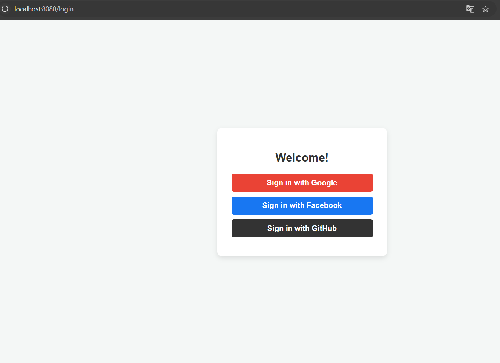
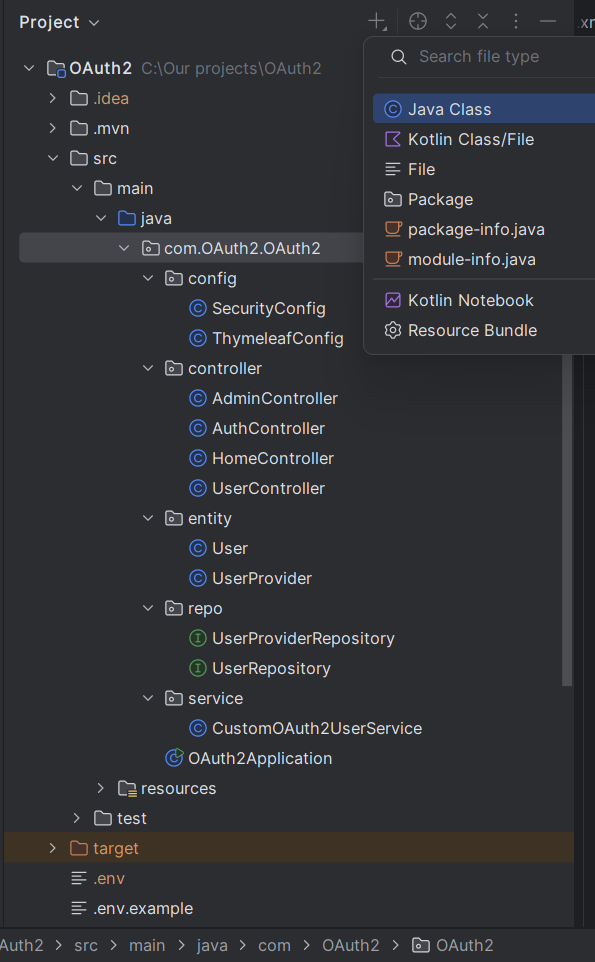

  # 🚀 Project Roadmap & Setup Guide
  # Secure Multi-Provider OAuth 2.0 & RBAC System in Spring Boot


  ## 📌 Project Overview
  A robust, production-ready Spring Boot 3.3.2 enterprise application implementing multi-provider social authentication (Google, Facebook, GitHub), intelligent account linking, and a secure Role-Based Access Control (RBAC) authorization model powered by Spring Security and Hibernate 6.5.2.
  
  
---

## 🗺️ Completed Milestones

### Phase 1: Environment & Secure Credentials Strategy
- [x] Implemented zero-hardcoding security practice using `.env` file configuration.
- [x] Integrated `dotenv-java` dependency to load environment variables programmatically at startup.
- [x] Configured `application.yml` to resolve system properties dynamically for database and OAuth credentials.
- [x] Kept credentials safe with `.env.example` templates for version control.

### Phase 2: Database Schema & Entity Normalization
- [x] Implemented JPA dynamic auto-detection with Hibernate 6.x.
- [x] Designed relational entity structures for **Account Linking**:
  - `User` entity (Parent record storing primary profile details).
  - `UserProvider` entity (Child records mapping distinct OAuth providers such as Google, GitHub, Facebook to one user via `One-to-Many` relationship).

### Phase 3: OAuth 2.0 Multi-Provider Custom Logic
- [x] Implemented custom `CustomOAuth2UserService` extending `DefaultOAuth2UserService`.
- [x] Normalized provider-specific attributes:
  - Mapped IDs (`sub` for Google, `id` for GitHub/Facebook converted via `String.valueOf()`).
  - Handled nested JSON picture responses.
  - Implemented automatic fallback email generation (`username@github.com`) to prevent `DataIntegrityViolationException` for private GitHub profiles.
- [x] Built **Account Linking Logic**: Unified multiple OAuth providers into a single user identity when matching primary emails are detected.

### 4. Role-Based Access Control (RBAC)
  * **Database-Driven Roles:** Each user is assigned a role (`ROLE_USER`, `ROLE_ADMIN`) persisted directly in the relational schema.
  * **Bridge Service (`CustomOAuth2UserService`):** Intercepts the OAuth2 login flow, fetches or provisions user records inside a transactional boundary, transforms database roles into Spring Security `GrantedAuthority` objects (`SimpleGrantedAuthority`), and injects them into the active `SecurityContext`.
  * **Method & Route Protection:** Configured in `SecurityConfig` via strict request matchers (`.hasAuthority("ROLE_USER")`).

### Phase 5: Security & Session Lifecycle
- [x] Configured `SecurityFilterChain` with Spring Security 6.x standards.
- [x] Resolved CSRF-compliant logout flow (supporting POST forms and `AntPathRequestMatcher`).
- [x] Created profile dashboard (`home.html`) powered by Thymeleaf.

---

## 🚀 How to Run the Project locally

### 1. Prerequisites
- **Java Development Kit (JDK):** Version 17 or higher
- **Build Tool:** Maven 3.8+
- **Database:** MySQL Server running locally on port `3306`

### 2. Database Preparation
Create a MySQL database instance:
```sql
CREATE DATABASE social_login_db;
```

### 3. Environment Setup (`.env`)
In the root directory of the project (at the same level as `pom.xml`), create a `.env` file:

```env
# Application Server
SERVER_PORT=8080

# Database Configuration
DB_URL=jdbc:mysql://localhost:3306/social_login_db?useSSL=false&serverTimezone=UTC&allowPublicKeyRetrieval=true
DB_USERNAME=root
DB_PASSWORD=your_mysql_password

# Google OAuth2 Credentials
GOOGLE_CLIENT_ID=your_google_client_id
GOOGLE_CLIENT_SECRET=your_google_client_secret

# Facebook OAuth2 Credentials
FACEBOOK_CLIENT_ID=your_facebook_client_id
FACEBOOK_CLIENT_SECRET=your_facebook_client_secret

# GitHub OAuth2 Credentials
GITHUB_CLIENT_ID=your_github_client_id
GITHUB_CLIENT_SECRET=your_github_client_secret
```

### 4. Running the Application
Run the Spring Boot application using Maven:
```bash
mvn clean spring-boot:run
```
Alternatively, execute `OAuth2Application.java` directly inside your IDE (e.g., IntelliJ IDEA).

### 5. Accessing the Application
Open your browser and navigate to:
```text
http://localhost:8080
```

## Architecture & Request Flow
[ User ] 
    │
    ▼ (1) Click Login (Google / GitHub / Facebook)
[ Spring Security Filter Chain ]
    │
    ▼ (2) Redirects to OAuth2 Provider & receives Authorization Code
[ OAuth2LoginAuthenticationFilter ]
    │
    ▼ (3) Fetches User Info & delegates to Custom Service
[ CustomOAuth2UserService ] ──(4) Account Linking & DB Check──► [ MySQL Database ]
    │                                                               (Users & UserProviders)
    ▼ (5) Maps Roles to GrantedAuthority & returns DefaultOAuth2User
[ SecurityContextHolder ] (Stores Authenticated Session & **RBAC** Authorities)
    │
    ▼ (6) Authorization check based on SecurityConfig rules (/user/**, /admin/**)
[ Protected Routes / Thymeleaf Views ]
## 📁 Project Structure

